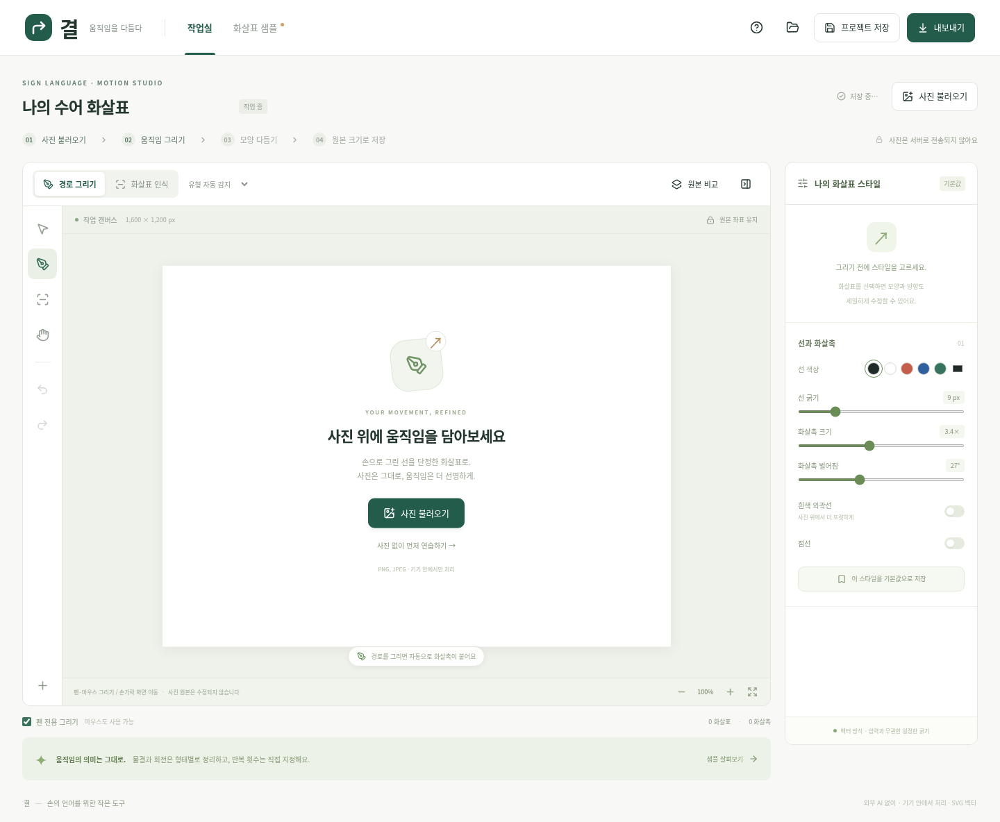

# 결 — 수어 화살표 작업실

사진 위에 손으로 그린 움직임을 깔끔한 SVG 화살표로 정리하는 한국어 웹앱입니다. **실제로 실행되는 클라이언트 앱**이며, 외부 AI API·서버·계정·API 키가 필요하지 않습니다. 사진과 편집 데이터는 브라우저 안에서 처리합니다.



## 맥에서 다운로드한 프로젝트 실행

`/workspace/ksl-arrow`는 Codex 클라우드 내부 경로입니다. 맥의 터미널에서는 이 경로를 사용할 수 없습니다. 프로젝트 ZIP을 맥의 **다운로드** 폴더에 저장하고 압축을 푸세요. GitHub에서 받은 ZIP은 보통 `ksl-arrow-main` 폴더로 풀립니다. 폴더 이름을 `ksl-arrow`로 맞춘 뒤 아래 명령을 실행하세요.

```bash
cd ~/Downloads/ksl-arrow
npm ci
npm run dev
```

그다음 맥의 브라우저 주소창에 `http://localhost:5173`을 입력합니다. 터미널은 서버가 실행되는 동안 열어 두고, 종료할 때는 `Control+C`를 누릅니다. 이 ZIP에는 소스와 검증한 `dist/` 빌드가 함께 포함됩니다.

## 실행

Node.js **22.12 이상**(24 권장)과 npm을 준비한 뒤 프로젝트 폴더에서 실행합니다.

```bash
npm ci
npm run dev
```

터미널에 표시된 개발 서버 주소를 브라우저에서 여세요. 기본 포트는 `5173`이며, 같은 네트워크의 다른 기기에서도 접속할 수 있도록 `0.0.0.0`에 바인딩합니다. iPad에서는 개발 컴퓨터의 네트워크 주소를 사용하거나, 아래 프로덕션 결과물을 HTTPS 정적 호스팅에 올려 접속합니다. 앱 사용자는 별도 설치가 필요하지 않습니다.

현재 Codex 클라우드에서 캐시 쓰기 경로를 지정하려면 다음 명령을 사용합니다.

```bash
npm ci --cache /workspace/.npm-cache
```

배포 가능한 정적 파일은 다음과 같이 만듭니다. `dist/`를 정적 호스팅에 배포하면 됩니다. 백엔드나 환경 변수는 필요하지 않습니다.

```bash
npm run build
npm run preview
```

## 사용 방법

1. **화살표 샘플**에서 직선·곡선·회전·물결·반복·원근·다중 촉·양방향의 접합과 곡선을 비교할 수 있습니다. ‘연습 캔버스에서 편집’으로 샘플을 바로 수정할 수 있습니다.
2. **사진 불러오기**로 PNG/JPEG를 엽니다. 원본 픽셀 크기와 비율을 유지하며, 사진 레이어는 잠깁니다. 사진 없이 연습하는 캔버스는 `1600 × 1200 px`입니다.
3. 입력 방식을 고릅니다.
   - **경로 그리기**: 이동 경로 한 획을 그리면 끝에 화살촉이 붙습니다. 자동 후보 또는 직접 지정한 유형으로 정리합니다.
   - **화살표 인식**: 경로와 V형 화살촉을 별도 획으로 그린 후 **변환**을 누릅니다. 시간이 지나도 자동 종료하지 않습니다. V형 촉을 두 획으로 나누어 그리거나, 경로→첫 날개→촉 끝→둘째 날개 순서로 이어 그리는 입력도 지원합니다.
4. **원본 비교**를 누르면 정리 결과 위에 손그림이 겹쳐 보이고, 다시 누르면 손그림만 보입니다. 원본 좌표·획 구분·순서·시간·진행 방향·압력을 보존합니다. 압력은 선 굵기에 사용하지 않습니다.
5. **선택·이동** 도구로 화살표를 선택합니다. 시작점·끝점은 원형 손잡이, 크기는 우하단 사각 손잡이, 회전은 위쪽 원형 손잡이로 바꿉니다. **제어점 편집**을 켜면 중간 경로점과 금색 화살촉 위치 손잡이도 나타납니다. 촉과 끝점이 겹치면 제어점 편집을 끈 상태에서 끝점을 옮기세요.
6. 오른쪽 속성에서 유형·방향·선·촉·외곽선·점선·물결·반복·원근을 수정합니다. 화살표를 선택하지 않았을 때는 다음에 그릴 화살표의 스타일을 편집합니다. ‘기본값으로 저장’하면 다음 방문에도 같은 스타일을 사용합니다.
7. **프로젝트 저장**으로 사진·손그림·편집 데이터를 함께 저장합니다. **프로젝트 열기**로 다시 편집할 수 있습니다. 자동 임시 저장은 이 브라우저의 IndexedDB에 저장하며, 새로 열 때 복구를 선택할 수 있습니다.
8. **내보내기**에서 픽셀 크기를 확인한 뒤 합성 PNG·투명 PNG·SVG·프로젝트 중 선택합니다. 변환 대기 획은 PNG/SVG에 포함되지 않으며 프로젝트에는 보존됩니다.

### 반복, 다중 화살촉, 왕복의 구분

- **→ →**: ‘반복과 원근 → 분리된 화살표 개수·간격’으로 별도 화살표를 만듭니다. 따로 그린 두 경로도 각각의 객체로 남습니다.
- **한 선 위의 두 촉**: ‘화살촉 추가’로 같은 경로에 촉을 놓고 위치를 조절합니다.
- **양방향**: 같은 경로의 `0%`에 역방향 촉, `100%`에 순방향 촉을 놓습니다. 인식 모드에서는 양끝의 V형 촉도 연결합니다.
- **두 경로의 왕복**: 진행 경로와 돌아오는 경로를 각각 그리세요. 각 경로를 독립적으로 편집합니다.
- **같은 경로를 두 번 회전**: 원본의 각도 진행량을 보존해 두 바퀴를 한 바퀴로 줄이지 않습니다. 명시적 반복 횟수는 별도 `laps` 데이터에 저장하고 **×N 표기**로 출력합니다. 횟수를 추측하거나 겹친 획을 삭제하지 않습니다. 이 표기는 분리된 반복 화살표를 생성하는 기능과 다릅니다.

‘몸에서 바깥으로/몸 쪽으로’는 경로의 시작점·끝점·촉 방향으로 직접 표현합니다. 사진을 보고 수어의 의미를 추정하지 않습니다. 원근은 **화면 앞으로/뒤로**를 사용자가 선택할 때만 폭이 점진적으로 변하는 리본으로 표시합니다. 원근 리본에는 점선을 적용하지 않습니다.

### 펜·손가락·마우스

- 기본 **펜 전용 그리기**에서는 Pencil/펜과 마우스로 그립니다. 손가락은 화면 이동에 사용합니다.
- 두 손가락 이동·벌리기로 화면을 이동·확대할 수 있습니다. 도구의 **화면 이동**, 하단 **확대·축소·화면에 맞춤**도 사용할 수 있습니다.
- 펜으로 그리는 도중 들어오는 다른 포인터의 터치 이벤트가 그 획을 종료하지 않도록 포인터 ID를 구분합니다. 완벽한 하드웨어 손바닥 차단을 보장하지 않습니다.
- 좌표는 SVG 화면 변환의 역행렬로 원본 좌표에 매핑합니다. 확대·화면 이동과 출력 배율은 분리되어 있습니다.
- 키보드: `P` 그리기, `V` 선택, `H` 화면 이동, `⌘/Ctrl+Z` 실행 취소, `⌘/Ctrl+Shift+Z` 다시 실행, `⌘/Ctrl+S` 프로젝트 저장, `⌘/Ctrl+D` 복제, `Delete` 삭제. 편집 이력은 최근 60단계입니다.

## 구현된 기능과 한계

| 영역        | 구현                                                                         | 한계·미구현                                                                                       |
| ----------- | ---------------------------------------------------------------------------- | ------------------------------------------------------------------------------------------------- |
| 정리        | 직선, 보간 곡선, 꺾임, 반원, 회전·기울어진 타원, 주기적 물결의 기하학적 후보 | 임의의 손글씨·모든 복합 경로의 완벽한 인식은 제공하지 않음                                        |
| 화살촉      | 별도 V형 촉, 두 획의 촉, 일부 연속 입력, 여러 촉, 양방향                     | 채워서 그린 촉·복잡한 낙서는 자동 인식 미지원. 수동 추가 필요                                     |
| 애매한 입력 | 원본 보관, 유형 후보, 수동 유형 지정, 원본 형태 유지                         | 여러 경로가 같은 촉에 비슷하게 가까우면 연결을 보류. 사용자 지정 필요                             |
| 움직임      | 시작·끝점, 방향, 주요 굴곡, 물결 횟수·진폭, 회전 진행량 보존                 | 물결은 끝점을 잇는 축을 기준으로 한 규칙적 파형. 심하게 비주기적인 파형은 ‘원본 형태’로 유지할 것 |
| 편집        | 선택·이동·복제·삭제·크기·회전·반전·경로점·끝점·촉 위치·앞뒤 순서·스타일 적용 | 단일 객체 선택. 개별 베지어 접선 손잡이·자동 의미 추론 미구현                                     |
| 출력        | 원본 크기 합성 PNG·투명 PNG·SVG, 편집 프로젝트 왕복 저장                     | 초대형 PNG는 기기 캔버스·메모리 한계에 따라 실패할 수 있음. SVG는 같은 크기로 출력 가능           |
| 복구        | IndexedDB 자동 저장, 재방문 복구, 스타일 기본값                              | 브라우저 저장소 삭제·시크릿 모드·용량 초과에 대비한 프로젝트 파일 저장 필요                       |
| 기기        | 반응형 UI, Pointer Events, 펜 전용·화면 이동 모드                            | 실제 iPad Safari·Apple Pencil·macOS Safari·Windows 실기기 테스트는 아직 미실시                    |

사진은 한 변 `32,000 px`, 입력 파일 `80 MB`, 프로젝트 파일 `120 MB`까지 받습니다. 프로젝트당 화살표 객체 300개, 원본 획 3,000개, 개별 화살촉 20개를 지원합니다. 분리된 반복은 최대 12개, 명시적 회전 반복 표기는 최대 20회입니다. 실제 처리 가능한 사진 크기는 기기 메모리에 따라 달라집니다. 출력 해상도를 인위적으로 늘리거나 ‘인쇄용 고해상도’로 표시하지 않습니다.

## 검증

```bash
npm test
npm run test:e2e
npm run build
npm run format:check
```

브라우저 테스트는 Playwright를 사용합니다. 현재 클라우드의 `/usr/bin/chromium`을 자동으로 사용하며, 다른 환경에서는 다음과 같이 브라우저를 설치합니다.

```bash
npx playwright install chromium
```

다른 Chromium 실행 파일을 사용할 때는 `PLAYWRIGHT_CHROMIUM_EXECUTABLE_PATH` 환경 변수로 경로를 지정할 수 있습니다. 앱 실행에는 이 변수가 필요하지 않습니다.

실제 검증 결과와 미검증 항목은 [검증 기록](docs/VALIDATION.md)에 구분해서 기록했습니다. 태블릿 폭의 Chromium 화면 검증과 합성 펜 이벤트는 실제 iPad Safari 검증을 대신하지 않습니다.

## 구조

- `src/model.ts`: 원본 획·스타일·화살표·프로젝트 모델
- `src/recognition.ts`: 유형 분석, 유형별 정리, 화살촉과 경로 연결
- `src/geometry.ts`: 경로 샘플링, 접선·화살촉·원근 리본, 변환
- `src/ArrowView.tsx`: 편집기·샘플·출력에 공통으로 사용하는 SVG 렌더러
- `src/Stage.tsx`: 포인터 입력, 좌표 변환, 확대·이동, 편집 손잡이
- `src/Inspector.tsx`: 유형·스타일·촉·반복·원근 속성
- `src/storage.ts`, `src/export.tsx`: 검증된 프로젝트 로딩, 임시 저장, 원본 크기 출력

런타임 네트워크 요청, 외부 AI 연동, 사용자 사진 업로드 기능은 없습니다. 빌드된 정적 파일을 제공하는 서버만 있으면 됩니다.
