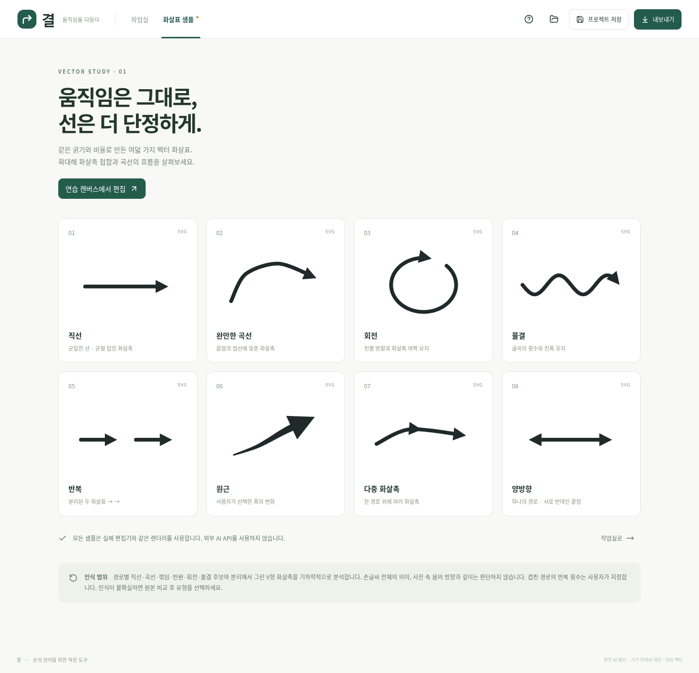

# 검증 기록

실행 환경: Linux, Node.js 24.19.0, npm 11.9.0, 시스템 Chromium + Playwright. 실행한 검사만 아래에 기록합니다.

## 자동 검사

### 엔진 테스트: 24개

`npm test`로 실행합니다.

- 직선 시작·끝점 유지
- 3회 물결을 직선으로 펴지 않으며 진폭 유지
- 시계·반시계 회전과 방향 반전
- 두 바퀴 회전의 진행량 유지, 횟수 추측 금지
- 꺾임 유지
- 반전 후 촉이 반대쪽 끝에 배치됨
- 1·1.5·2·2.5회 물결의 반전 전후 공간 경로 일치
- 짧은 곡선·급한 꺾임의 유한한 촉 도형과 크기 제한
- 늦게 그린 V형 촉 연결
- 분리된 두 화살표와 한 경로의 두 촉 구분
- 두 획으로 그린 촉, 일부 연속 입력 지원
- 양방향 촉 유지
- 왕복 경로·겹친 원본 획을 임의 삭제하지 않음
- SVG 크기·좌표와 사진 미포함 확인
- 프로젝트 왕복 저장 및 손상 입력 거부
- 동일 끝점의 애매한 연결 보류
- 기울어진 타원의 장축 방향 유지

### 브라우저 작업 흐름: 9개

`npm run test:e2e`로 실행합니다. 각 테스트의 브라우저 JavaScript 오류가 없는지도 검사합니다.

1. 사진 업로드 → 경로 그리기 → 방향 반전·촉 추가 → PNG/SVG 다운로드. PNG의 실제 IHDR 픽셀 크기, 빈 부분의 알파 `0`, 선의 알파 `255`, 합성 이미지의 원본 배경색을 확인합니다.
2. 인식 모드에서 첫 경로를 그린 후 시간이 지나도 완료되지 않으며, 늦게 그린 V형 촉을 하나의 화살표로 연결합니다.
3. 확대 2회와 화면 이동 뒤 그린 획의 시작·끝점이 지정한 원본 좌표와 일치합니다.
4. 복제·삭제·실행 취소·다시 실행과 기본 스타일 저장을 확인합니다.
5. JSON 프로젝트를 다시 열고 편집한 뒤, 페이지를 다시 열어 IndexedDB 임시 저장에서 같은 객체를 복구합니다.
6. 합성 Pointer Events로 펜의 압력과 포인터 종류를 보존하고, 중간에 들어온 손가락 이벤트가 펜 획을 종료하거나 추가하지 않는지 확인합니다. 선 굵기는 압력과 무관하게 유지됩니다.
7. 8종 샘플 카드와 `1024`, `768`, `390 px` 폭에서 가로 넘침 없이 작업실이 표시되는지 확인합니다.
8. 지원하지 않는 프로젝트 입력이 기존 화살표를 지우지 않는지 확인합니다.
9. 화살표 몸통 드래그, 끝점, 촉 위치, 크기, 회전 손잡이가 실제 저장 데이터에 반영되는지 확인합니다.

## 설치·프로덕션 확인

- `npm ci --cache /workspace/.npm-cache`로 의존성을 다시 설치한 뒤 `npm run build`(TypeScript 검사와 Vite 정적 빌드)를 통과했습니다.
- `npm run format:check`를 통과했습니다.
- 개발 서버 시작 명령과 내부 HTTP 요청을 확인했습니다.
- `npm run preview -- --port 4173`으로 빌드 결과를 별도로 실행했습니다. HTTP 200, 샘플 8개, 편집 가능한 화살표 8개, `1600 × 1200` 좌표계의 SVG 다운로드를 확인했고 브라우저 JavaScript 오류는 없었습니다.

## 화면 검토

같은 SVG 렌더러가 생성한 8종 샘플을 Chromium에서 실행하고 스크린샷으로 검토했습니다. 몸통·촉 접합, 원형 화살표의 여백, 곡선과 물결 흐름, 반복과 다중 촉의 시각적 차이를 확인했습니다.

## 미검증·제한

- **실제 iPad Safari와 Apple Pencil 미검증**. 합성 이벤트는 펜 하드웨어, 필기 지연, 브라우저의 실제 손바닥 차단을 검증하지 않습니다.
- macOS Safari, Windows 및 Android 실기기 미검증.
- 원본 크기 출력은 생성한 `900 × 600 px` PNG 사진으로 픽셀 검증했습니다. 모든 카메라의 EXIF 회전·색상 프로파일과 대형 사진의 기기별 메모리 제한은 검증하지 않았습니다.
- 인식은 규칙 기반이며 위의 테스트 입력을 통과했습니다. 임의의 실제 사용자 필기 데이터셋에 대한 인식률 측정은 하지 않았습니다.
- 공개 호스팅 배포 및 다른 클라우드 작업에서의 스냅샷 복원은 이 검증 범위에 포함하지 않습니다.
